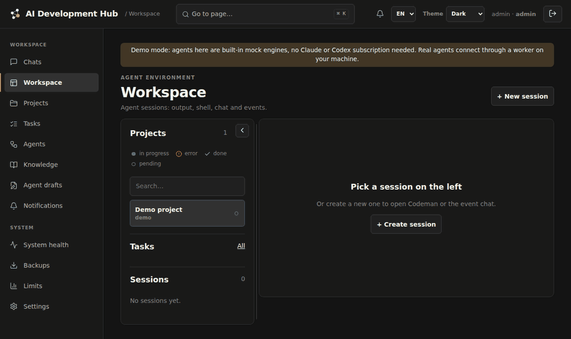

<p align="center">
  
</p>

<h1 align="center">AI Development Hub</h1>

<p align="center">
  A self-hosted control room for AI coding agents.<br>
  Run <b>Claude Code</b> and <b>Codex</b> on your own machines and subscriptions, watch every session live,
  let an orchestrator split work across git branches, and give agents a shared, reviewable memory in your
  Obsidian vault.
</p>

<p align="center">
  <a href="https://github.com/mrazall/ai-development-hub/actions/workflows/ci.yml"></a>
  <a href="LICENSE"></a>
  
  <a href="https://github.com/mrazall/ai-development-hub/releases"></a>
</p>

<p align="center">
  <b>New in 0.2.0-alpha:</b> a Windows desktop app, any number of Claude/Codex accounts with hand-over between
  them, and a sign-in that stays. <a href="https://github.com/mrazall/ai-development-hub/releases/tag/v0.2.0-alpha">Release notes</a>
</p>



<sub>Recorded in the built-in demo mode: the agents are mock engines that echo the task, so it runs without any
subscription. Real sessions look the same with Claude Code or Codex output.</sub>

> **Status: alpha.** It runs the author's homelab every day: real Claude Code and Codex sessions, orchestration and
> notes. Expect rough edges. Read [Limitations](#limitations) and [SECURITY.md](SECURITY.md) first.

## Why

Agent CLIs are great in a terminal and awkward everywhere else:

- a session lives in one terminal on one machine; close the laptop and it is gone;
- a provider limit stops a long job halfway, and you restart it by hand when the window resets;
- every run starts from zero: there is no memory the next agent can search, and no review of what agents
  "remember";
- two agents on one checkout step on each other's files.

AI Development Hub keeps the agents **where their logins, tools and code already are — your machines** — and gives
you one panel for all of them. Subscription logins never leave the workers: each CLI logs in there, the official
way, under its own per-account config directory.

## What you can do with it

**Watch and steer agents from anywhere on your network.** Start a Claude Code or Codex session on any registered
machine from the browser (or your phone over Tailscale), follow its output live, open a shell in its working
folder, look at the git diff, and send follow-up messages. Attach files to a task — pick them, drop them, or
paste them from the clipboard.

**Decide what an agent may do.** Each Claude Code session has a permission mode: *edits only* (file edits, no
commands), *ask* (every other action becomes an approval in the panel — Allow or Reject, with a notification),
*auto* (Claude Code's own auto mode decides and blocks risky actions) or *allow everything*. You can change it
when you continue a session.

**Let long jobs survive limits.** When a subscription limit stops a session, the hub schedules it to resume the
moment the limit resets, in the same CLI conversation — or you continue it right away on another account.

**Use every subscription you have.** Add as many Claude Code and Codex accounts as you like; the hub gives each
its own profile folder on the worker (logins stay separate, history and settings are shared), shows who is
signed in where, and detects a login that already exists on the machine.

**Split a task between agents.** In orchestrated mode a Claude orchestrator publishes a plan, starts up to four
Codex executors, each in its own git worktree and branch, reviews their work and merges it. You see the plan,
every executor's branch, changed files, token usage and cost. With *manual merge* on, the orchestrator asks and
you press *Accept*.

**Give agents a memory you control.** Your Obsidian vault is indexed for hybrid search (Postgres full text +
Qdrant vectors) and exposed to agents through an MCP server. Agents never edit your notes: they write **drafts**
into one folder; you review a draft, and one click lets a model merge it into the right notes as a git commit
— one more click reverts it. Browse the vault as a list or a link graph.

**Chat with your notes.** Personal Claude chats that can search the vault; choose the account, model and effort
per message.

**Know when something breaks.** A System health page checks workers, Tailscale, account limits, the index,
backups and recent failures, and sends a notification when a check fails or recovers. A failed session you have
looked at can be marked *all good* so it stops showing as a problem.

**Stay signed in.** The panel keeps you signed in until you sign out or don't use it for 30 days (rotating device
tokens in an httpOnly cookie) — on every device separately.

## Why self-hosted

- **Your subscriptions, your machines.** Agents run where you already installed and logged in the CLIs. No
  hosted service in between and no telemetry.
- **Your code and notes stay local.** The hub is Docker Compose on a laptop or a home server; workers connect
  *out* to it, so worker machines need no open ports.
- **Private network first.** Bind to `127.0.0.1` and reach it over Tailscale/WireGuard. The repository ships a
  home-server template with Tailscale in a container.
- **Plain, inspectable parts.** FastAPI, Postgres, Qdrant, React; Alembic migrations; restic backups; Apache-2.0.

## Quickstart: the demo (about 5 minutes)

Needs Docker with Compose v2 and `openssl`. Nothing is exposed beyond `127.0.0.1`.

```bash
git clone https://github.com/mrazall/ai-development-hub && cd ai-development-hub
./scripts/quickstart.sh --demo
```

Open http://127.0.0.1:58080 and sign in as `admin`; the generated password is in `.aihub/admin-password` (the
`.aihub/` folder holds all local secrets, mode 0700, git-ignored). The demo worker runs **mock engines** — they
echo the task or write a file — so you can create sessions, chat and browse the demo vault without any
subscription. Orchestration needs real agents and is not part of the demo.

Stop it with `./scripts/quickstart.sh --down` (data volumes are kept); `--reset` deletes the demo's data and
`.aihub/` to start over.

## Real agents

1. Start the hub without the demo: `./scripts/quickstart.sh`, or deploy it on a server —
   [docs/deployment.md](docs/deployment.md).
2. On each machine with Claude Code and/or Codex (Linux or WSL2), run a worker — [docs/workers.md](docs/workers.md).
3. **Settings → Accounts**: add a profile per subscription (or adopt a login the worker already has) and log
   the CLI in once under that profile — the panel gives you the exact command.
4. Point the knowledge service at your vault (`AIHUB_VAULT_HOST_DIR`) — [docs/configuration.md](docs/configuration.md).

## Windows desktop app

A small Tauri app for Windows 10/11 that turns a PC into a worker without touching a terminal:

- **Setup wizard** — checks WSL2 (Ubuntu with systemd), installs the worker there or adopts one you already run,
  registers the machine with your hub and offers to log in the agent CLIs.
- **Tray** — the Nodes mark animates while agents are working; double click opens the panel full screen.
- **Settings inside the panel** — in the app, the panel's *Settings* page gets a *Windows app* block: worker
  state, updates, start with Windows, restart worker, worker log.
- **Updates from your own hub** — releases are signed with your key and served by the hub at
  `/desktop/latest.json`; the app checks daily and installs on your confirmation.

Download the installer from the [latest release](https://github.com/mrazall/ai-development-hub/releases).
It is not code-signed yet, so Windows SmartScreen will warn: *More info → Run anyway*. The released installer has
self-updates **off** — they need *your* key. To turn them on, generate one
(`npx @tauri-apps/cli signer generate -w <file outside the repo>`), put the public key into
`plugins.updater.pubkey` in `apps/desktop/src-tauri/tauri.conf.json`, set `bundle.createUpdaterArtifacts` to
`true`, build the installer with `TAURI_SIGNING_PRIVATE_KEY` and `TAURI_SIGNING_PRIVATE_KEY_PASSWORD` set, and
copy the installer, its `.sig` and a `latest.json` into the hub's data volume under `desktop/`.

The installer is also built by GitHub Actions for every release tag (`.github/workflows/desktop.yml`), and can be
run by hand from the Actions tab.

## How it works

```
 browser ──HTTPS──▶  hub (control plane + panel) ──▶ Postgres, knowledge service (Qdrant, embeddings)
                         ▲            ▲
          poll / events  │            │  MCP (memory, orchestration)
                         │            │
             worker on machine A   worker on machine B ──▶ claude / codex CLIs, git worktrees
```

- **Hub** — FastAPI control plane and the React panel: users and roles, projects, sessions and their event log,
  orchestration, settings, health, notifications.
- **Knowledge service** — indexes the vault (read-only mount), hybrid search, the link graph, agents' drafts.
- **Worker** — a small Python process per machine. It polls the hub for work, runs the CLI in the project
  folder, streams events back and keeps per-account CLI config directories.
- **MCP server** — gives agents the memory and, for orchestrators, the orchestration tools, with short-lived
  scoped tokens.

More: [architecture](docs/architecture.md) · [configuration](docs/configuration.md) ·
[engines](docs/engines.md) (adding another agent CLI) · [workers](docs/workers.md) ·
[deployment](docs/deployment.md).

## Limitations

- **Agents are not sandboxed by this project.** They run with your user's rights on the worker, in the project
  folder. Codex uses its own `workspace-write` sandbox; for Claude Code you pick the permissions per session
  (below). Use a dedicated user or VM for workers when that matters. See [SECURITY.md](SECURITY.md).
- **Not for the open internet.** There is no login rate limiting; keep the panel on a private network.
- **Workers run on Linux or WSL2.** macOS and native Windows workers are untested.
- **Subscriptions.** Running Claude Code / Codex through your own subscription for your own work is how this was
  built; check your provider's terms for anything beyond that.
- **UI languages:** English and Russian (some server-generated details are still Russian only).

## Development

```bash
scripts/dev/dev-db.sh          # Postgres and Qdrant for development
scripts/predeploy-check.sh     # lint and every test suite, incl. user scenarios with a real (mock-engine) worker
```

Tests never call paid models. See [CONTRIBUTING.md](CONTRIBUTING.md).

## License

Apache License 2.0 — see [LICENSE](LICENSE).
