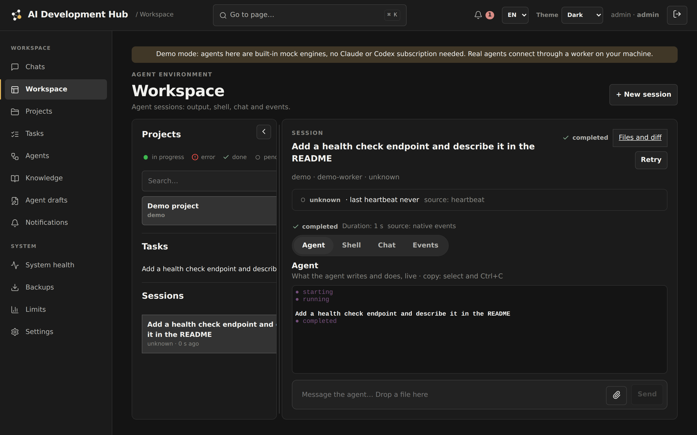
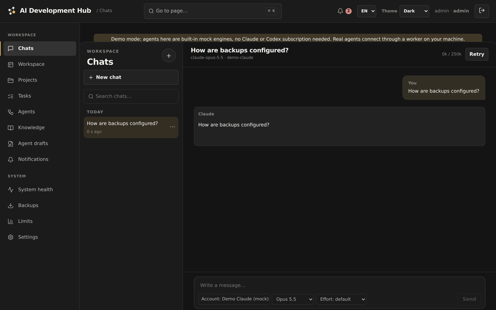
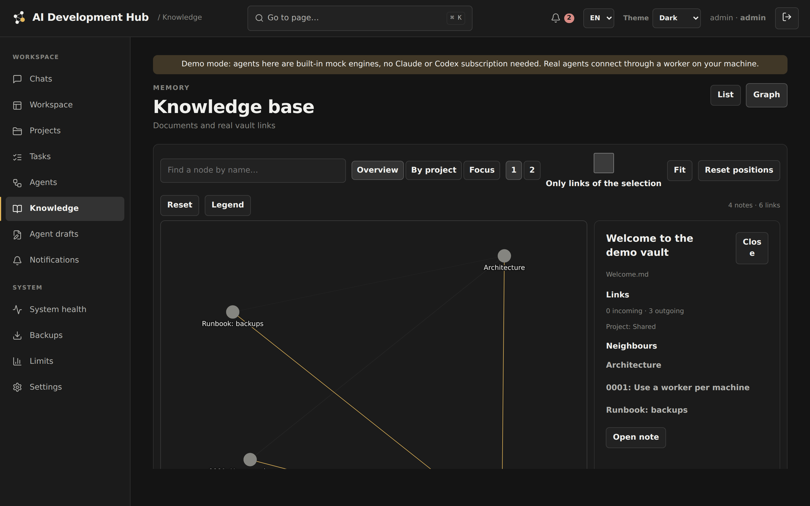

# AI Development Hub

A self-hosted control room for AI coding agents. Run **Claude Code** and **Codex** on your own machines and
subscriptions, watch every session live, let an **orchestrator** split a task between executors on git
branches, and give all agents a shared, reviewable **memory** in your Obsidian vault.

> Status: **alpha**. It runs a real homelab every day, but expect rough edges. See [Limitations](#limitations).



| Chats with memory | Knowledge graph |
|---|---|
|  |  |

## Why

Agent CLIs are great in a terminal and awkward everywhere else: sessions die with the laptop lid, limits
interrupt long jobs, there is no shared memory between runs, and parallel agents step on each other.
The hub keeps the agents where their logins and tools are (your machines) and gives you one panel for them.

## Features

- **Workspace** — sessions of Claude Code / Codex on any registered worker: live terminal-style view, chat,
  shell, events, files and git diff. Attach files to a task.
- **Orchestration** — an orchestrator (Claude) publishes a **plan**, starts up to N **executors** (Codex) on
  their own git worktrees and branches, reviews and merges them. Optional **manual merge**: it asks, you click
  *Accept*. Token usage, cost and account limits per executor.
- **Memory** — your Obsidian vault, indexed for hybrid search (Postgres full text + Qdrant vectors), exposed to
  agents through an MCP server. Agents never edit notes directly: they save **drafts**; you review them and one
  click lets a model merge a draft into the right notes with a git commit (and one click reverts it).
- **Chats** — personal Claude chats with access to the memory; choose account, model and effort per message.
- **Resilience** — sessions stopped by a provider limit **resume automatically** when it resets; a **System
  health** page (workers, Tailscale, limits, index, backups, errors) with notifications on failures.
- **Your infrastructure** — a hub (Docker Compose) plus a worker process on each machine. No hosted service, no
  telemetry. Works over a private network such as Tailscale.

## Quickstart (demo, 5 minutes)

Needs Docker with Compose v2.

```bash
git clone https://github.com/mrazall/ai-development-hub && cd ai-development-hub
./scripts/quickstart.sh --demo
```

Open http://127.0.0.1:58080, sign in as `admin` (the password is in `.aihub/admin-password`). The demo worker
runs **built-in mock engines**, so you can create sessions, chat and browse the demo vault without any
subscription. Stop with `./scripts/quickstart.sh --down`.

## Real agents

1. Start the hub without the demo: `./scripts/quickstart.sh` (or deploy it on a server, see
   [docs/deployment.md](docs/deployment.md)).
2. On each machine with Claude Code and/or Codex installed, run a worker — [docs/workers.md](docs/workers.md).
3. In the panel: **Settings → Accounts** — add a profile per subscription and log the CLI in once.
4. Point the knowledge service at your vault (`AIHUB_VAULT_HOST_DIR`) — [docs/configuration.md](docs/configuration.md).

## How it works

```
 browser ──HTTPS──▶  hub (control plane + panel) ──▶ Postgres, knowledge service (Qdrant, embeddings)
                         ▲            ▲
          poll / events  │            │  MCP (memory, orchestration)
                         │            │
             worker on machine A   worker on machine B ──▶ claude / codex CLIs, git worktrees
```

Details: [docs/architecture.md](docs/architecture.md). Adding another agent CLI:
[docs/engines.md](docs/engines.md).

## Limitations

- Agents run with real shell access on the worker machine, scoped to project folders by convention, not by a
  sandbox. Read [SECURITY.md](SECURITY.md) before exposing anything.
- Subscriptions: running Claude Code / Codex through your own subscription for your own work is how this was
  built; check your provider's terms for anything beyond that (shared or commercial use).
- The UI language is English and Russian.

## Development

```bash
scripts/predeploy-check.sh   # lint, all tests incl. end-to-end user scenarios with a real worker
```

See [CONTRIBUTING.md](CONTRIBUTING.md).

## License

Apache License 2.0 — see [LICENSE](LICENSE).
